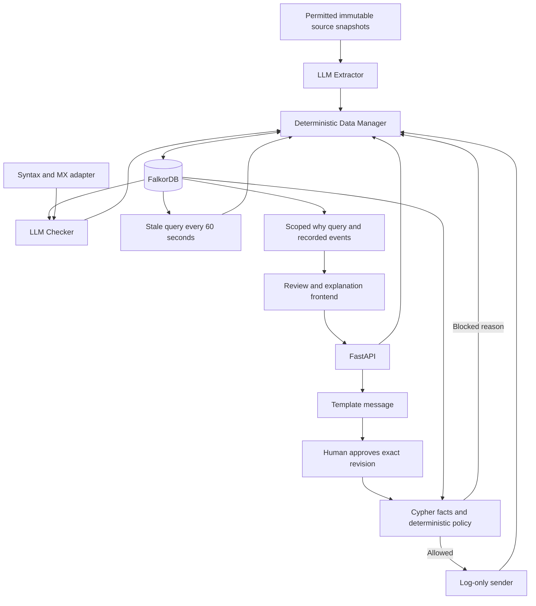

# LeadLedger — accepted implementation plan

Team: Kunal and Shubhangi. Primary track: **Agents That Act on Connected Data**; supporting capability: **Agent Memory and Coordination**. One active B2B SaaS partnerships campaign, twenty synthetic source records, eighteen canonical people, and a historical campaign fixture for cross-campaign blocking.

## Architecture



Only the Extractor and Checker are LLM roles. The Data Manager, Gatekeeper and Sender do not use an LLM. Fixture adapters let each teammate demonstrate their piece without the other's implementation or a paid API key. Label all fixture data and reports. No external emails are sent.

## Graph model

Preserve the business path:

```text
Company -HAS_CONTACT-> Person -VERIFIED_BY-> Verification
Verification -QUALIFIED_FOR-> Campaign -AUTHORIZED_BY-> Approval -SENT_AS-> Outreach
```

Add a Lead enrollment per campaign/source record. Explicitly bind Approval to the exact Lead, Person, Verification and Draft. Shared Campaign connectivity alone cannot authorize a send.

| Label | Main properties |
|---|---|
| Company | id, name, domain, industry |
| Person | id, name, role, email_normalized, identity_key, contact_version, opted_out, suppressed |
| Lead | id, source_record_id, company_id, person_id, campaign_id, state, version, duplicate, duplicate_of_id, current artifact IDs, event_sequence |
| Campaign | id, name, industry, target_role, policy_version, verification_ttl_seconds, mode |
| Evidence | id, source_id, source_uri, source_kind, snapshot_text, content_hash, captured_at, is_fixture |
| Verification | id, lead_id, person_id, campaign_id, contact_version, status, checked_at, valid_until, report_json, model metadata |
| Draft | id, lead_id, person_id, campaign_id, revision, to_address, from_address, subject, body_text, mode, message_hash |
| Approval | id, lead_id, person_id, campaign_id, verification_id, draft_id, contact_version, message_hash, policy_version, approved_by, approved_at, revoked |
| Outreach | id, lead_id, person_id, campaign_id, approval_id, draft_id, message_hash, status, mode, idempotency_key, sent_at, outcome, simulated |
| Event | id, lead_id, sequence, type, actor, at, from_state, to_state, command_id, payload_json |
| Command | id, fingerprint, result_json, http_status |

Every node also has created_at. API DTOs hide graph-private properties and decode JSON reports/payloads. IDs are application strings; timestamps are UTC seconds.

Additional relationships: Person HAS_LEAD Lead; Lead IN_CAMPAIGN Campaign; Lead DISCOVERED_FROM Evidence; Lead HAS_VERIFICATION Verification; Lead HAS_DRAFT Draft; Lead HAS_APPROVAL Approval; duplicate Lead DUPLICATE_OF canonical Lead; Verification SUPPORTED_BY Evidence; Approval BASED_ON Verification; Approval APPROVES Draft; Outreach FOR_LEAD Lead; Outreach TO Person; Outreach USES_DRAFT Draft. Lead and causal artifacts HAS_EVENT Event. Every relationship has a stable application ID.

## Required behavior and Cypher

The executable, parameterized queries are checked in under `leadledger/queries/`:

- `stale.cypher`: flags qualified or approved Leads whose current Verification expired or belongs to an older contact version. The Manager appends an event, clears approval and transitions to Stale.
- `gate.cypher`: retrieves the current Person, Lead, Campaign, Verification, Draft and Approval, their explicit bindings, supporting evidence, and any prior Outreach through the canonical Person across campaigns.
- `why.cypher`: traverses the exact Outreach's historical evidence/approval path, constrained through its Lead and Draft.
- `why_events.cypher`: returns events attached to the exact Verification, Approval and Outreach.

Gate rules: verification passed and fresh; not opted out or suppressed; not duplicate; not previously contacted; correct state; approval not revoked; approved person, campaign, verification, contact version and policy match; recomputed message hash matches the approved Draft. Missing or ambiguous graph facts block sending. A preflight is advisory and is rerun at send time.

Hash canonical JSON containing campaign_id, person_id, recipient, sender, subject, body_text and mode. Preserve message text, sort keys and SHA-256 UTF-8 bytes. See `message-hash-vector.json`.

One worker/process per graph serializes mutations. Each write guards expected versions and commits state, artifacts, events and command receipts in one graph query. LLM work runs outside the mutation lock and cannot commit a result against changed context. Append-only history is an application guarantee, not a tamper-proof ledger claim.

## State transitions

| From | Trigger | To |
|---|---|---|
| New | Candidate persisted | Discovered |
| Discovered | Check requested | Verification pending |
| Verification pending | Supported report and deterministic checks pass | Approved |
| Verification pending | Missing/conflicting evidence or unavailable Checker | Needs review |
| Verification pending | Deterministic invalid address/domain | Rejected |
| Approved | Create Draft | Awaiting outreach approval |
| Awaiting outreach approval | Human approves exact current Draft | Approved for sending |
| Approved for sending | Gate passes; log-only result commits | Sent |
| Approved / Awaiting outreach approval / Approved for sending | Expired verification or changed contact | Stale |
| Stale / Needs review | Recheck | Verification pending |
| Rejected | Explicit reopen with new evidence | Verification pending |
| Approved for sending | Message revision | Awaiting outreach approval |
| Sent / Delivery/Reply status | Simulated outcome | Delivery/Reply status |
| Any | Opt out canonical contact | Opted out |

Opted out is terminal; later outcomes append history without reopening it. Duplicate source records are rejected and cannot be reopened. A blocked send appends an event without changing business state. Interrupted verification goes to Needs review at startup.

## Shared interfaces and ownership

The full wire shapes, endpoints, retries and replacement-adapter signatures are in [docs/CONTRACTS.md](docs/CONTRACTS.md), `schemas.json`, `openapi.json` and `examples.json`. Preserve contract version 1.0.0 during initial integration.

| Kunal | Shubhangi |
|---|---|
| Graph schema, seeds, repository and Data Manager | Permitted source registry and real Extractor |
| States, history, stale scanning and policy gate | Evidence-backed real Checker and syntax/MX adapter |
| Approval integrity and final send orchestration | Message drafting/template and log-only sender adapter |
| FastAPI and historical why query | Frontend review, approval and Cytoscape explanation view |

Kunal can demo the real graph API with labelled fixture adapters. Shubhangi can demo agents plus frontend using the shared mock payloads. Integrate their adapters and switch frontend mocks to real API at build hour 8. Her sender returns a result; Kunal commits it after policy approval.

## Build order

| Hours | Outcome |
|---|---|
| 0–1 | Freeze JSON/API contracts and ownership |
| 1–3 | Seeds, why query, stale query and blocking query; mock frontend |
| 3–5 | Data Manager/state guards; structured agents |
| 5–7 | Gate, approvals and sender boundary; evidence review |
| 7–8 | HTTP adapter and approval controls ready |
| 8–10 | Integrate backend, agents and frontend; happy path |
| 10–12 | Stale/opt-out/idempotency/error handling |
| 12–14 | Real-graph integration tests and persistence check |
| 14–16 | Fix defects, local setup docs, rehearsal and demo recording |

Keep a separate submission buffer. Official event page lists October 18, 2026, 11:59 PM IST; verify registration/submission details in the event dashboard. [Official event](https://www.wemakedevs.org/hackathons/falkordb)

## Risks and cut-lines

Avoid unsupported Cypher assumptions: real-graph tests come first. Keep exact artifact bindings to prevent Campaign cross-links authorizing the wrong contact. Validate citations and quotes before passing reports. Treat network/provider failures as uncertainty. No real mailbox-existence claim follows from syntax/MX checks.

Drop in this order: third agent, live source fetching, Mailpit, MCP wrapper, hosted deployment and animation polish. Retain real FalkorDB, two agent roles, human approval, message binding, suppression/contact history, stale work selection and evidence-path rendering.

## Acceptance and demo

Verify happy path; expiry before and after scan; opt-out at every stage; duplicate and cross-campaign blocking; old message approval rejection; contact/policy changes; invalid or invented evidence; DNS uncertainty; retry/concurrent send idempotency; graph failure; historical explanation after later changes; restart recovery and persistence. Backend tests exercise real FalkorDB. Live LLM, Docker-container recreation and frontend visual QA require their respective runtime/integration work.

Four-minute demo: 25s problem/context, 60s discover→verify→approve→simulated send, 30s stale query, 40s blocked sends, 60s exact why graph and evidence clicks, 25s restart/persistent history. Label simulated sends and fixture execution clearly. Use API docs as Kunal's independent demo until the frontend is integrated.
