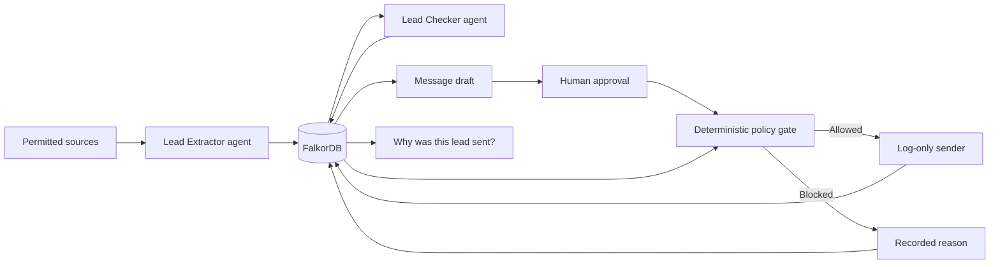

# LeadLedger

**Find leads. Verify the evidence. Approve the message. Explain every send.**

LeadLedger is a hackathon prototype for a multi-agent lead-generation workflow with **FalkorDB as shared memory and the decision layer**. The graph connects contacts, evidence, verification reports, campaigns, approvals, and outreach history.

Built by **Kunal and Shubhangi** for Graph Hacks.

> **Backend branch:** `kunal/backend` includes the real FalkorDB workflow, API, seeds, policy gates and explanation queries. The current agent adapters are labelled fixture replay; the live agents and frontend still need integration. No real emails are sent.

## Run the backend

See [local setup and demo commands](docs/BACKEND.md), [the integration guide](docs/CONTRACTS.md), and [the accepted plan](PLAN.md).

**Windows:** use the [PowerShell + Docker instructions](docs/BACKEND.md#windows-powershell-use-docker-not-falkordblite). Embedded FalkorDBLite does not support native Windows. With a running Docker database, the full test command is `python -m pytest --graph-backend=server`; the `local` extra is unnecessary.

```bash
python3 -m venv .venv
source .venv/bin/activate
python -m pip install -e '.[local,test]'
export LEADLEDGER_DB=embedded
python -m leadledger.seed
python -m uvicorn leadledger.api:app --host 127.0.0.1 --port 8000 --workers 1
```

Open `http://127.0.0.1:8000/docs`. In another terminal, run `python scripts/demo.py`. Embedded mode uses real FalkorDB; macOS requires the `libomp` runtime. Docker setup is also provided in `compose.yaml`.

## The workflow



Two LLM agents extract and check leads. The Data Manager, policy gate, and sender are deterministic components.

The gate requires:

- A passed, current verification.
- No opt-out, suppression, or duplicate record.
- No prior contact in the active or another campaign.
- Human approval for the exact contact, verification, and message revision.
- An unchanged message since approval.

Current workflow state is stored alongside an append-only event history.

## MVP boundaries

- One active campaign, one industry: B2B SaaS partnerships.
- Twenty synthetic lead records, including stale, duplicate, opted-out, and previously contacted cases.
- A small registry of permitted source snapshots.
- Log-only outreach. **No real emails are sent.**
- Fixture replay is labelled; synthetic DNS checks are not represented as live verification.
- No multi-tenancy, unrestricted scraping, or production authentication.

## Shared contracts — start here

| File | Purpose |
| --- | --- |
| [openapi.json](openapi.json) | HTTP routes and request/response formats, contract version 1.0.0 |
| [schemas.json](schemas.json) | Standalone JSON Schema definitions for agent and backend payloads |
| [examples.json](examples.json) | Mock requests and responses for parallel development |
| [message-hash-vector.json](message-hash-vector.json) | Canonical message JSON and its expected SHA-256 hash |

The planned local API is `http://127.0.0.1:8000/api`.

Every lead-changing request carries a fresh UUID `command_id` and the lead's current `expected_version`. Retry an identical request with the same command ID. Approval refers to a specific `draft_id` and `message_hash`.

Agents return structured reports with evidence IDs and supporting quotes. They do not write arbitrary graph data or authorize sends.

## Work split

| Kunal — backend | Shubhangi — agents and interface |
| --- | --- |
| FalkorDB setup, graph schema, and seed loading | Permitted sources and Lead Extractor |
| Data Manager, states, and event history | Evidence-backed Lead Checker |
| Stale queries and policy gate | Email syntax and MX validation adapters |
| Approval integrity and send orchestration | Message template and log-only sender function |
| FastAPI routes and historical explanation query | Lead review, approval controls, and explanation graph |

Kunal's backend calls the sender only after a fresh gate check, then commits the outcome and audit events. The sender itself does not write to the database.

Suggested branches: `kunal/backend` and `shubhangi/agents-ui`. Build against the shared contracts and flag format changes before changing field names. Integrate around build hour 8.

## Required demo

1. Discover → verify → draft → human approval → simulated send.
2. Auto-flag a stale verification through a graph query.
3. Block a send because of opt-out or prior contact.
4. Ask **“Why was this lead sent?”** and display its recorded evidence and approval chain.
5. Restart and retrieve the same history.

## Planned stack

Python, FastAPI, Pydantic, the official FalkorDB Python client, and a small HTML/JavaScript frontend with Cytoscape.js. FalkorDB runs locally; Docker is the standard setup, with embedded FalkorDB being evaluated for development.

The prototype does not require paid hosting or a paid email service. Live LLM access depends on the selected provider's availability and quota; labelled fixtures support offline development.

## Hackathon fit

Primary track: **Agents That Act on Connected Data** — graph-driven actions, multi-hop evidence paths, and explainable decisions.

Supporting capabilities: **Agent Memory and Coordination** — persistent shared context and handoffs between the Extractor and Checker.

## References

- [Graph Hacks — official event](https://www.wemakedevs.org/hackathons/falkordb)
- [FalkorDB Docker setup](https://docs.falkordb.com/operations/docker)
- [FalkorDB Python client](https://github.com/FalkorDB/falkordb-py)
- [FalkorDB Cypher compatibility](https://docs.falkordb.com/cypher/cypher-support)
- [Cytoscape.js](https://js.cytoscape.org/)

This is a hackathon prototype. The approval flow and audit history demonstrate the architecture; they are not a claim of production readiness.
