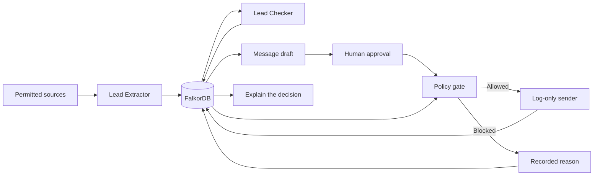

# LeadLedger

**Find leads. Check the evidence. Approve before sending.**

Finding a potential customer is only the first step. The information might be outdated, the contact might be a duplicate, or the person might have already been contacted or opted out.

LeadLedger is a graph-powered lead-generation prototype built with FalkorDB. It connects leads to their source evidence, verification reports, message drafts, approvals, and outreach history. The goal is to make lead generation more than a list of names and email addresses: every decision should have an explanation you can trace back to the information behind it.

> **Project status:** Hackathon prototype in development. Outreach is simulated; no real emails are sent.

## Repository and demo

- **GitHub:** [rexyrocks/leadledger](https://github.com/rexyrocks/leadledger)
- **Demo dashboard:** [Open LeadLedger](https://leadledger.live/ui/)
- **Demo video:** [Watch the narrated walkthrough](https://youtu.be/AdjHO9bNQAk) — labelled fixture replay with synthetic records and log-only sends.
- **Demo API docs:** [Explore the API](https://leadledger.live/docs)

The demo uses the custom domain `leadledger.live` through a named Cloudflare tunnel. It is available while the local app and tunnel are running on the host Mac; stopping them or putting the Mac to sleep takes the demo offline. Demo records are synthetic and sending is **log-only: no real emails are sent**.

> **Integrated workspace:** `main` includes Qwen Extractor/Checker adapters, conservative email checks, human-reviewed Qwen drafts and the local review UI. FalkorDB retains all state and send decisions. Seeded reports are labelled fixtures; Qwen is an explicit runtime mode. No real emails are sent.

See [agents and UI setup](docs/AGENTS_UI.md). Quick start after installing dependencies: `python scripts/run_workspace.py --agents fixture --seed`, then open `http://127.0.0.1:8123/ui/`.

## Inspect a decision

Open **Decision Lab** on any lead to see the current gate, ten policy checks, the executed Cypher and the graph facts behind it. Try an opt-out, suppression, expired verification or changed message against a read-only copy of those facts. These scenarios use the same evaluator as sending and never alter approvals or campaign history.

**Demo guide** helps reviewers find existing examples without resetting the shared graph. The Qwen badge checks actual connection readiness; fixture replay remains separately labelled. See [Decision Lab and verification](docs/DECISION_LAB.md).

## Run the backend

See [local setup and demo commands](docs/BACKEND.md), [the integration guide](docs/CONTRACTS.md), and [the accepted plan](PLAN.md).

**Windows:** use the [PowerShell + Docker instructions](docs/BACKEND.md#windows-powershell-use-docker-not-falkordblite). Embedded FalkorDBLite does not support native Windows. With a running Docker database, the full test command is `python -m pytest --graph-backend=server`; the `local` extra is unnecessary.

```bash
python3 -m venv .venv
source .venv/bin/activate
python -m pip install -e '.[local,test]'
export LEADLEDGER_DB=embedded
python -m leadledger.seed
python -m uvicorn leadledger.api:app --host 127.0.0.1 --port 8000 --workers 1
```

Open `http://127.0.0.1:8000/docs`. In another terminal, run `python scripts/demo.py`. Embedded mode uses real FalkorDB; macOS requires the `libomp` runtime. Docker setup is also provided in `compose.yaml`.

## The problem

Lead-generation workflows often bring together information from multiple sources without making it easy to understand how reliable that information is or why a contact was selected.

A useful workflow needs to answer more than *“Who should we contact?”*

- Where did this information come from?
- Does the available evidence support the contact's details?
- Is the verification still current?
- Has this person opted out or already been contacted?
- Who approved the message, and has it changed since approval?
- Why was an action allowed or blocked?

LeadLedger explores how a graph database and a controlled, multi-agent workflow can help answer these questions.

## How it works



The workflow is built around a few key components:

- **Lead Extractor:** identifies candidate leads and structures the information found in permitted source records.
- **Lead Checker:** evaluates lead details against stored evidence and returns a structured assessment.
- **FalkorDB:** connects leads, evidence, verification reports, campaigns, approvals, and outreach history so decisions can use shared context.
- **Policy gate:** deterministically checks whether the required conditions for a simulated send are satisfied.
- **Human approval:** ensures the message is approved for the specific contact and revision rather than granting blanket permission to send.
- **Audit history:** records outcomes and reasons so decisions can be investigated later.

The agents provide structured assessments; they do not independently authorize outreach. The policy gate makes the final decision.

## Graph data model

FalkorDB stores the application records and their relationships, rather than serving only as a visualization layer. `Company` connects to `Person`; each `Person` has campaign-specific `Lead` records. A lead links to its source `Evidence`, `Verification`, `Draft`, `Approval`, and ordered `Event` history. An `Approval` binds the exact draft and verification; an `Outreach` links back to its lead, recipient and saved draft. `Command` records support idempotent retries. Only the Data Manager writes graph state.

The core queries are committed in [gate.cypher](leadledger/queries/gate.cypher), [stale.cypher](leadledger/queries/stale.cypher), [why.cypher](leadledger/queries/why.cypher), and [why_events.cypher](leadledger/queries/why_events.cypher). See [the backend implementation](leadledger/manager.py) for write guards and orchestration.

## Key features

### Evidence-backed lead verification

Lead information is evaluated against stored source snapshots. Verification reports reference evidence IDs and supporting quotes, making it easier to inspect the basis for a claim.

A source quote shows what the source recorded; it is not, by itself, proof that the information is true.

### Graph-based context

FalkorDB acts as the shared context layer, connecting information that would otherwise be scattered across separate records. This supports checks involving previous contact, duplicate records, stale verification, and approval history.

### Human approval before outreach

A message must be approved for the relevant contact, verification, and message revision. If the message changes after approval, the previous approval must not authorize the changed message.

### Deterministic send controls

Before a simulated send is permitted, the policy gate checks for a current, passed verification; opt-outs and suppression conditions; duplicate or previous-contact restrictions; and valid approval for the unchanged message.

### Explainable decisions

LeadLedger is designed to answer **“Why was this lead sent?”** by tracing the recorded evidence, verification, approval, and policy decision. Blocked actions should also have recorded reasons.

## Demo scenarios

The planned demo covers the full workflow and several failure cases:

1. **Discover and verify:** process a candidate lead and inspect its supporting evidence.
2. **Approve and simulate:** review a message, approve the exact draft, and record a simulated send.
3. **Detect stale verification:** use graph-based checks to identify verification that is no longer current.
4. **Block inappropriate outreach:** demonstrate a block caused by an opt-out or previous contact.
5. **Explain the outcome:** inspect why a send was permitted or blocked and follow its audit trail.
6. **Recover history:** restart the application and retrieve previously recorded history.

These are intended demo scenarios; individual capabilities should be considered complete only when implemented and verified.

## Tech stack

- **Python** — workflow logic and agent adapters
- **FastAPI** — HTTP API
- **Pydantic and JSON Schema** — structured payloads and contract validation
- **FalkorDB** — graph storage and connected context
- **HTML, JavaScript, and Cytoscape.js** — lead review interface and graph visualization
- **Docker** — local database setup

The prototype is designed for local development without paid hosting or a paid email service. Live LLM functionality depends on the selected provider and available quota; labelled fixtures support offline development.

## Getting started

### Prerequisites

- Python 3.12 or later
- Docker Desktop with Linux containers enabled
- Git

### Setup

Clone the repository and enter its directory:

```bash
git clone https://github.com/rexyrocks/leadledger.git
cd leadledger
```

Create and activate a virtual environment, then install the project with its test dependencies.

**Windows PowerShell:**

```powershell
python -m venv .venv
.\.venv\Scripts\Activate.ps1
python -m pip install -e ".[test]"
```

Start FalkorDB:

```powershell
docker compose up -d --wait
```

Run the test suite using the server-backed graph configuration:

```powershell
python -m pytest --graph-backend=server
```

For additional setup details, consult [`docs/BACKEND.md`](docs/BACKEND.md). The API is intended to run locally at `http://127.0.0.1:8000/api`; consult the backend instructions for the current launch command.

## Project structure

| Path | Purpose |
|---|---|
| `leadledger/` | Backend package, contracts, adapters, repository, and API |
| `leadledger/queries/` | Graph queries for policy checks, stale verification, and explanations |
| `schemas.json` | Shared JSON Schema definitions |
| `openapi.json` | API contract |
| `examples.json` | Example request and response payloads |
| `message-hash-vector.json` | Canonical message and expected SHA-256 hash |
| `tests/` | Automated tests |
| `scripts/` | Contract checks and demo utilities |
| `docs/` | Backend instructions, contracts, and project documentation |

See [`docs/CONTRACTS.md`](docs/CONTRACTS.md) for the shared data contracts and [`PLAN.md`](PLAN.md) for implementation planning.

## Scope and limitations

The initial MVP focuses on one B2B SaaS partnerships campaign with 20 synthetic lead records, including stale, duplicate, opted-out, and previously contacted cases.

- Outreach is log-only. No real emails are sent.
- Fixture replay is labelled and must not be mistaken for live LLM or DNS verification.
- Email checks do not attempt SMTP mailbox probing.
- The prototype does not provide production authentication, multi-tenancy, or unrestricted scraping.
- Approval and audit controls demonstrate the intended architecture; they are not a claim of production readiness.

## Hackathon track

LeadLedger is designed for **Agents That Act on Connected Data**, using graph relationships to inform actions and make their outcomes explainable. It also explores **Agent Memory and Coordination** through shared context between the Extractor and Checker.

## AI assistance disclosure

OpenAI Codex assisted with implementation, tests, documentation, interface work, and deployment troubleshooting. Qwen is the optional runtime model for extraction, evidence checking, and drafting; it has no authority to approve or send outreach. The demo video uses Kokoro-generated narration and recorded interface captures from a separately labelled fixture replay. All demo contacts are synthetic and sending is log-only.

## References

- [Graph Hacks](https://www.wemakedevs.org/hackathons/falkordb)
- [FalkorDB Docker setup](https://docs.falkordb.com/operations/docker)
- [FalkorDB Python client](https://github.com/FalkorDB/falkordb-py)
- [FalkorDB Cypher compatibility](https://docs.falkordb.com/cypher/cypher-support)
- [Cytoscape.js documentation](https://js.cytoscape.org/)
